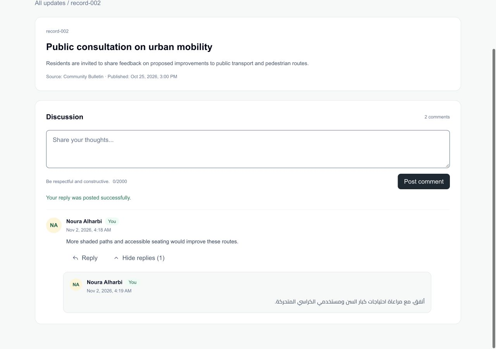
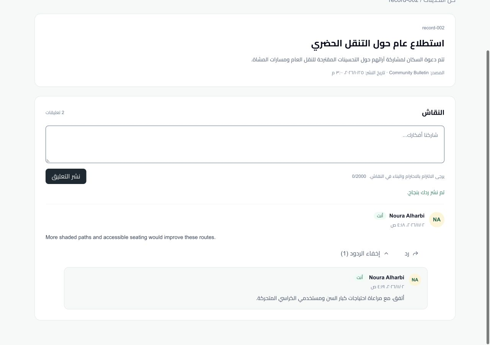
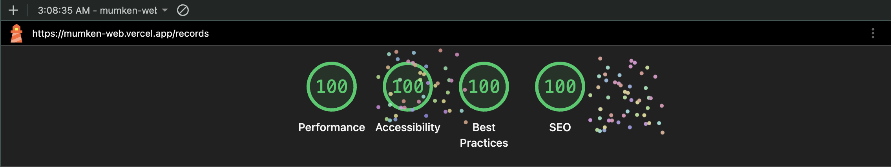
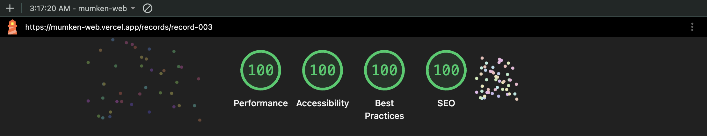

# Mumken Web

A discussion app for reading updates, posting comments, and replying in English or Arabic. Built with Next.js 16, React 19, TypeScript, Tailwind CSS 4, and Vitest.

## Run

Requires Node.js 20.9 or later.

```sh
npm ci
npm run dev
```

Open [localhost:3000](http://localhost:3000).

For production:

```sh
npm run build
npm start
```

If the environment prevents Turbopack from starting its local worker, use `npm run build -- --webpack`. The Webpack production build has been verified locally.

## Checks

```sh
npm test
npm run lint
npx tsc --noEmit
```

## Features

- Update list and discussion pages, with one level of replies.
- English/LTR and Arabic/RTL layouts on desktop and mobile browsers.
- Empty-input validation, a 2,000-character limit, and duplicate-submission protection.
- Failed submissions keep the draft for retry; successful posts show a green confirmation.
- Loading, empty, unavailable, and error states. The list skeleton has four cards.
- A startup overlay on first load or refresh, followed by the skeleton. It stays for at least 1.2 seconds and waits for the Arabic font, with a three-second fallback.
- Collapsible replies, composer focus on Reply, keyboard focus styles, status announcements, and reduced-motion support.

## Data and storage

| Data | Lifetime |
| --- | --- |
| Comments and replies | In memory across navigation; reset to the JSON seed on refresh. |
| Language | Saved in `localStorage`; restored on later visits. If storage is blocked, it lasts for the current visit. |
| Draft and reply target | Temporary form state; failed submissions retain both. |

There is no backend or authentication. The supplied current user is used for all submissions. Authored comments keep their original language. Timestamps are stored in UTC and displayed in the viewer's timezone.

## Demo scenarios

Open each URL with a full reload. Failures happen once per session; retry succeeds. The demo URLs also work in production.

| Scenario | URL |
| --- | --- |
| Four-second loading | `/records?demo=loading` |
| Initial load failure | `/records?demo=initial-error` |
| Discussion load failure | `/records/record-001?demo=load-error` |
| Failed comment | `/records/record-002?demo=submit-error` |
| Failed reply | `/records/record-001?demo=submit-error` — choose Reply first |
| Empty discussion | `/records/record-002` |
| Missing update | `/records/missing` |

Normal discussion loads and submissions simulate a 1.2-second delay. Initial list data loads immediately, while the startup overlay still runs. `NEXT_PUBLIC_INITIAL_LOAD_DELAY_MS` sets the request delay at build time (0–2,000 ms); it does not change the overlay timing.

## Screenshots

The [English and Arabic walkthrough](docs/journey/README.md) has 19 screenshots covering startup, the main journey, recovery, and mobile-browser layouts. It complements the submitted Loom recordings.

<details>
<summary>Successful discussion: English and Arabic</summary>

| English | العربية |
| --- | --- |
|  |  |

</details>

## Lighthouse

The supplied runs scored 100 in Performance, Accessibility, Best Practices, and SEO for `/records` and `/records/record-003`. They were captured before the latest startup and feedback changes; rerun Lighthouse for current scores.

<details>
<summary>View the captured results</summary>





</details>

## Implementation notes

The PDF defines the scope, the JSON supplies the seed, and Figma provides the visual reference. The update list was inferred because the design supplied only the discussion screen. The shared reply composer and collapsible threads are implementation choices.

React Context owns the session and language. A repository handles sample data, validation, and simulated requests. The composer, threads, state views, and UI controls are separate components. Small translation dictionaries cover the interface without an i18n library.

## Limits and next steps

Comments are plain text and session-only. There is no backend sync, pagination, or multi-user conflict handling. Automated accessibility checks and Lighthouse scores do not replace keyboard and screen-reader testing.

Next steps would be end-to-end browser tests, further assistive-technology checks, and pagination if discussions grow.
